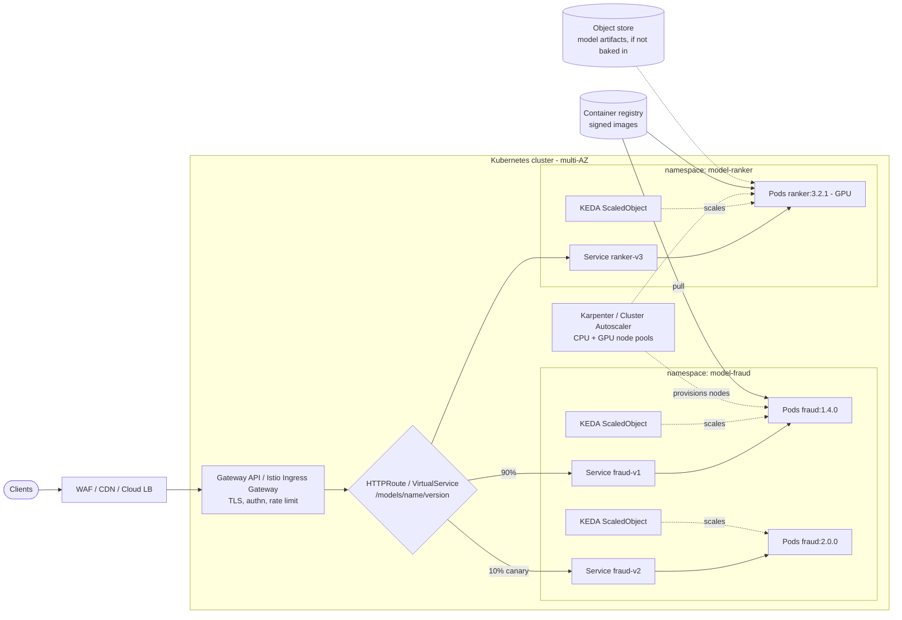
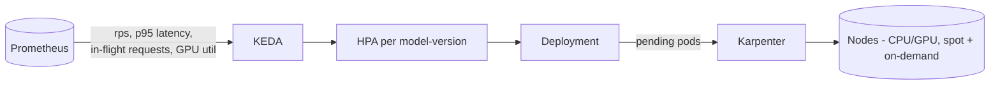
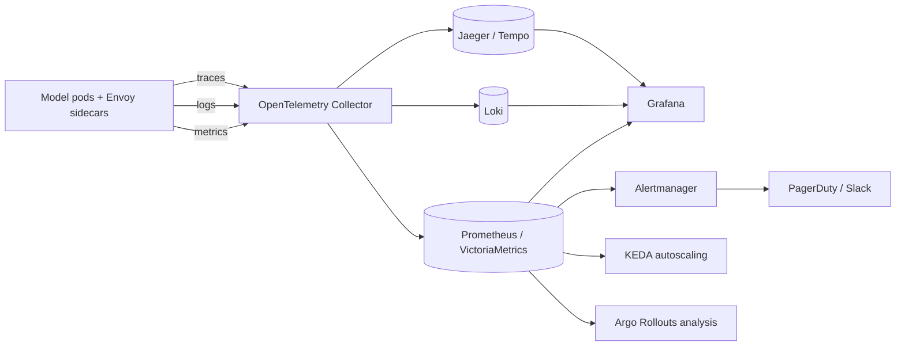
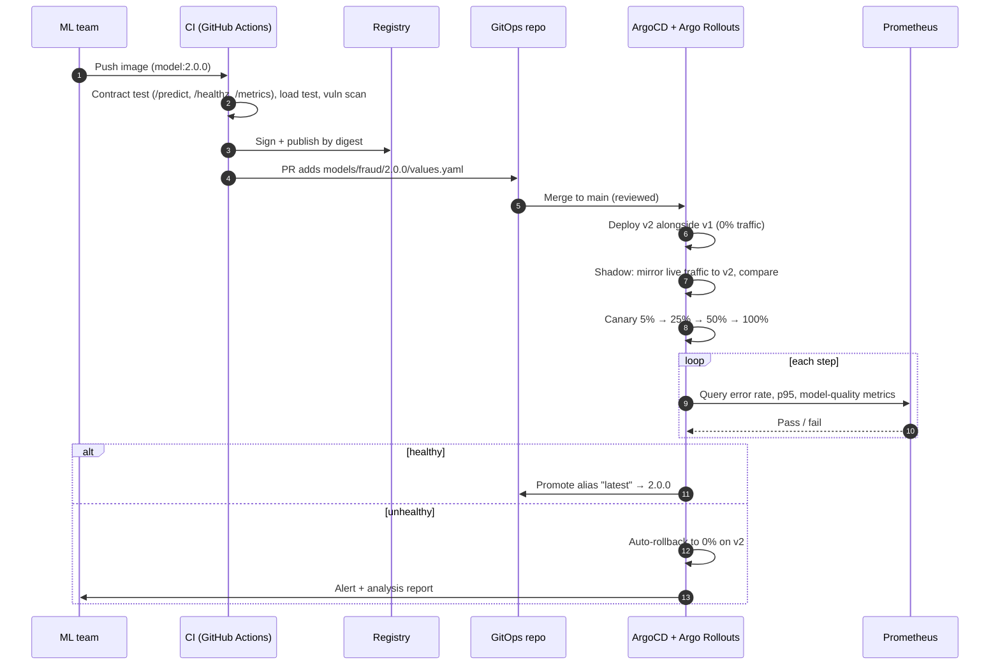

# Scalable Multi-Model Inference Service — Design

Hosts ML-team-supplied Docker images (one inference request per HTTP call, predefined endpoints). Many models and many versions of each run side by side, each scaling independently.

This repository also contains a runnable demo of the shared-runtime variant (KubeRay + Ray Serve, deployed by ArgoCD). See [Demo](#demo-ray-serve-on-an-existing-argocd-cluster) at the end.

## Contents

1. [Requirements and assumptions](#1-requirements-and-assumptions)
2. [Architecture](#2-architecture)
3. [Infrastructure toolkit](#3-infrastructure-toolkit)
4. [Monitoring and observability](#4-monitoring-and-observability)
5. [Operations](#5-operations)
6. [Trade-offs and alternatives](#6-trade-offs-and-alternatives)

## 1. Requirements and assumptions

| Requirement | Design response |
|---|---|
| Models arrive as Docker images with fixed HTTP endpoints | Treat each image as an opaque, immutable artifact; platform adds no code to it |
| Many models, many versions, simultaneously | One Kubernetes `Deployment` per *model-version*, in a namespace per model |
| Independent scaling | One autoscaler per model-version (KEDA/HPA), own resource requests and node pool |
| Resilient and reliable | Multi-AZ, PDBs, probes, retries/circuit breaking at the mesh, no shared state between versions |

Assumptions: synchronous request/response inference, mix of CPU and GPU models, public cloud Kubernetes (EKS/GKE/AKS), models contract = `POST /predict`, `GET /healthz`, `GET /metrics` (Prometheus) — enforced by CI conformance tests, not by trust.

## 2. Architecture



### 2.1 Request path

1. Clients hit a managed edge (WAF, CDN, cloud load balancer) then the in-cluster **Gateway** (Gateway API with Istio or Envoy Gateway). TLS termination, authN (JWT/mTLS), and global rate limits live here.
2. Routing is by path `/models/<name>/<version>/…`, plus an alias route `/models/<name>/latest` whose weights are what we change during rollouts. Clients that need strict reproducibility pin a version.
3. Each route targets a per-version `Service` backed by that version's pods. Versions share nothing: no common process, no common pool. A bad version cannot starve another.

### 2.2 Per-model-version unit (the "model package")

Every model-version is rendered from one Helm chart / Kustomize base into:

- `Deployment` (image pinned by **digest**, not tag), `Service`, `HTTPRoute` rule
- `ScaledObject` (KEDA) / `HPA`
- `PodDisruptionBudget`, `NetworkPolicy`, `ServiceAccount` (least privilege, IRSA/Workload Identity for artifact access)
- `ServiceMonitor` and `PrometheusRule` (SLO alerts)
- resource requests/limits, `nodeSelector`/tolerations (GPU pool vs CPU pool), topology spread across AZs

The ML team only supplies: image, resource profile, scaling bounds, and a tiny values file. Everything else is platform-owned defaults.

### 2.3 Independent scaling



- **Pods:** KEDA scales on model-relevant signals — in-flight requests per pod (primary), request rate, GPU utilisation — not just CPU. Each version has its own `minReplicas`/`maxReplicas` and stabilization windows.
- **Scale to zero** for low-traffic or old versions (KEDA HTTP add-on / Knative); `minReplicas ≥ 2` for tier-1 models.
- **Nodes:** Karpenter provisions the cheapest fitting node (spot for burst, on-demand baseline), separate GPU and CPU pools. Warm images via pre-pull DaemonSet or image caching to cut cold start.
- **Cold start:** large model weights baked into the image or pulled from a node-local cache; `startupProbe` gates traffic.
- **Guardrails:** `ResourceQuota` + `LimitRange` per namespace so one model cannot consume the cluster; `PriorityClass` for tier-1 models.

### 2.4 Resiliency and reliability

| Concern | Mechanism |
|---|---|
| Node/AZ failure | Pods spread across ≥3 AZs (`topologySpreadConstraints`), PDBs keep a minimum available during drains |
| Bad pod | Readiness/liveness/startup probes; Envoy outlier detection ejects failing endpoints |
| Slow/failed upstream | Per-route timeouts, bounded retries on idempotent predictions with retry budgets, circuit breakers (connection/request caps) |
| Overload | Gateway rate limits, per-pod concurrency cap, load shedding (HTTP 429/503) rather than queue collapse |
| Noisy neighbour | Namespaced quotas, requests = limits for GPU, dedicated node pools for critical models |
| Bad release | Progressive delivery with automated rollback (see §5) |
| Bad config/infra change | Everything in Git, reviewed, applied by ArgoCD; rollback = `git revert` |
| Control plane / region | Cluster is cattle: recreated from Terraform + ArgoCD in minutes. For tier-1, run active-active in 2 regions behind global DNS/LB with health-based failover |
| Supply chain | Images scanned (Trivy), signed (cosign), admitted only if signature verifies (Kyverno / Sigstore policy-controller); only from the approved registry |
| Data/secret safety | SOPS/External Secrets, no secrets in images, mTLS in mesh, default-deny NetworkPolicy |

SLOs (per model-version, defaults): availability 99.9% of non-4xx requests, p95 latency target set with the ML team per model. Error budgets gate rollouts.

## 3. Infrastructure toolkit

| Layer | Tool | Why |
|---|---|---|
| Cloud infra (VPC, K8s, node roles, registry, buckets, DNS) | **Terraform / OpenTofu** with modules, remote state + locking | Declarative, widest provider support, plan/review in PRs. Separate state per environment |
| Cluster add-ons and workloads | **ArgoCD** (GitOps), app-of-apps / ApplicationSets | Git is the source of truth, drift detection + self-heal, easy rollback, audit trail |
| Packaging | **Helm** for platform charts, one reusable `model-service` chart for models; Kustomize overlays per env | One chart = consistent defaults; ML team only edits values |
| Autoscaling | **KEDA**, **Karpenter** | Metric-driven per-model scaling; fast, right-sized node provisioning |
| Traffic | **Gateway API + Istio** (or Envoy Gateway), **Argo Rollouts** / Flagger | mTLS, weighted routing, retries; progressive delivery with metric analysis |
| Secrets | **SOPS + age** or External Secrets Operator | GitOps-compatible, no plaintext in Git |
| Policy | **Kyverno** / OPA Gatekeeper, cosign | Enforce limits, probes, signed images, no `latest` tags |
| CI | **GitHub Actions** | Lint, conformance test, scan, sign, publish values change |
| Cluster-level tests | kind in CI | Same stack runs locally for PR validation |

Repo layout (mono-repo, environment promotion by directory):

```
infra/terraform/{modules,envs/{dev,staging,prod}}
platform/                 # ArgoCD, Istio, KEDA, Karpenter, observability
models/<name>/<version>/values.yaml   # one small file per model-version
charts/model-service/     # shared chart
```

A new model-version is a PR that adds `models/<name>/<version>/values.yaml`; an ApplicationSet (git directory generator) discovers it and creates the Application automatically.

**Why Kubernetes and not Lambda/SageMaker endpoints/ECS?** Arbitrary images, GPU support, per-version scaling and traffic shaping, no vendor lock-in, and one operational model for platform and models. SageMaker/Vertex are good if the team prefers to buy rather than operate; the contract (Docker image + HTTP) lets us migrate either way.

## 4. Monitoring and observability



**Metrics (the four golden signals, labelled by `model`, `version`):**
- Traffic: requests/s; Errors: 4xx/5xx rate; Latency: p50/p95/p99 from mesh (Envoy) so it works for any image; Saturation: in-flight requests, CPU/mem, GPU util + memory, queue depth.
- Platform: pod restarts, OOMKills, pending pods, scale events, cold-start duration, node provisioning time, image pull time.
- Model-specific (optional, from the model's `/metrics`): inference time vs total time, batch size, model load time.
- Cost: per-model-version CPU/GPU hours (OpenCost) via labels.

**Logs:** structured JSON to stdout, collected by the OTel Collector → Loki, with `trace_id` for correlation.

**Traces:** W3C trace-context propagated from the gateway through to the model; sampled (tail sampling keeps errors and slow requests).

**ML-quality observability (beyond infra):** log a sampled, privacy-reviewed record of inputs/outputs to object storage; compute drift and prediction-distribution metrics (Evidently/WhyLabs) offline or as a sidecar job; alert on drift per version. Shadow/canary comparison feeds this.

**Dashboards:** one templated Grafana dashboard per model-version (generated, not hand-built), a fleet overview, and a rollout dashboard comparing canary vs stable.

**Alerting:** multi-window multi-burn-rate SLO alerts (page on fast burn, ticket on slow burn). Examples: error budget burn, p95 above SLO, pods crash-looping, scaling pinned at max, GPU saturation, drift detected. Every alert links a runbook.

## 5. Operations

### 5.1 Rolling out a new model version



Principles:

- **Versions are additive and immutable.** v2 is a new Deployment; v1 keeps running untouched, so rollback is a routing change (seconds), not a redeploy.
- **Staged environments:** dev → staging (synthetic + replayed traffic) → prod, promoted by Git PR.
- **Gates:** contract test, performance regression vs previous version, canary metric analysis, optional manual approval for tier-1 models.
- **Deprecation:** once a version has no traffic for N days, scale to zero, then remove its values file (Argo prunes). Registry images are retained for reproducibility.
- **Rollback:** automatic on failed analysis; manual via `git revert` or setting weights back.

### 5.2 Updating services (models, platform configuration)

- Config/chart changes go through the same PR → ArgoCD flow; `selfHeal` reverts manual drift.
- Model Deployments use `RollingUpdate` with `maxUnavailable: 0`, readiness gates, and PDBs, so config changes don't drop requests. Pods use `preStop` + `terminationGracePeriodSeconds` to drain in-flight requests.

### 5.3 Updating infrastructure

| Change | Approach |
|---|---|
| Terraform changes | PR → `plan` posted as comment → approval → `apply` in CI; env promoted dev → staging → prod |
| Kubernetes version upgrade | Blue/green clusters preferred for prod (new cluster via Terraform, ArgoCD syncs workloads, shift traffic via DNS/LB weights); alternatively in-place control plane then rolling node-pool replacement honouring PDBs |
| Node OS / AMI | Karpenter drift replaces nodes gradually; respects PDBs and disruption budgets |
| Platform add-ons (Istio, KEDA, Prometheus) | Pinned chart versions; Renovate PRs; test in dev/staging; canary revisions for Istio (revision-based upgrade) |
| CRD ordering | Sync waves / app-of-apps (as in `apps/bootstrap`) |
| Disaster recovery | Cluster rebuild from Git (RTO minutes); persistent data only in managed stores (object storage, managed DB) with backups; DR game days quarterly |

### 5.4 Day-2

- Runbooks per alert, on-call rotation shared between platform and ML team (platform owns the platform, ML owns model correctness).
- Capacity and cost review monthly (right-size requests from VPA recommendations, spot ratio).
- Security: continuous image scanning, dependency updates, periodic secret rotation, audit logs.

## 6. Trade-offs and alternatives

| Choice | Alternative | Reason for choice |
|---|---|---|
| One Deployment per model-version | Shared multi-model server (Triton, Ray Serve, Seldon MLServer) | ML team ships *arbitrary* images, so per-version isolation is simple and gives independent failure and scaling domains. Cost: more pods and idle overhead; mitigated with scale-to-zero. A shared server is better when many tiny models share one runtime or GPU |
| KEDA + HPA | Knative | Knative gives scale-to-zero and request-based revisions out of the box but adds its own control plane; KEDA is lighter and composes with the existing mesh |
| Istio | Linkerd / Envoy Gateway only | Istio gives the richest traffic shaping (mirroring, weights, outlier detection); Linkerd is lighter if mesh features are not needed |
| ArgoCD | Flux | Both fine; ArgoCD's UI and ApplicationSets help ML team self-service |
| Kubernetes | Managed endpoints (SageMaker, Vertex) | Portability and GPU/traffic control vs. higher operational burden |
| Single region by default | Multi-region active-active | Cost/complexity only justified for tier-1 SLOs |

## Demo: Ray Serve on an existing ArgoCD cluster

The demo implements the shared-runtime option from §6: one RayService per model *family*, each model version a Ray Serve application with its own route prefix and autoscaling bounds. Pod-level scaling is per version (Serve replicas) and node-level scaling is handled by the Ray autoscaler (`enableInTreeAutoscaling`).

| Design element | Where |
|---|---|
| GitOps via ArgoCD | `apps/*/application.yaml` |
| Ray operator | `helm/kuberay-operator`, `apps/kuberay-operator` |
| Versioned model hosting | `helm/mlmodel-ray` (`serve.applications`), `apps/random-forest`, `apps/logistic-regression` |
| Optional Istio routing | `istio.enabled` in `helm/mlmodel-ray` |

Differences from the primary design: versions of a family share one Ray cluster and image (weaker isolation), and the models are wrapped by platform-owned Ray code instead of arbitrary ML-team images. The primary design's per-version Deployment remains the choice for opaque images.
