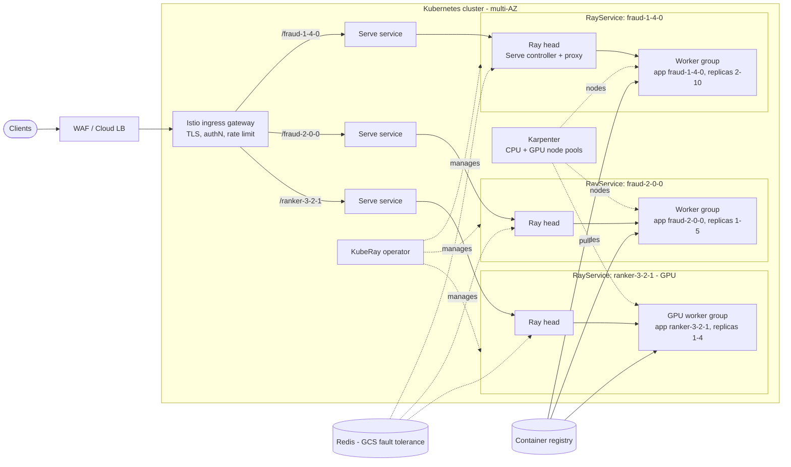
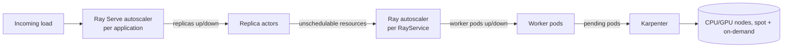
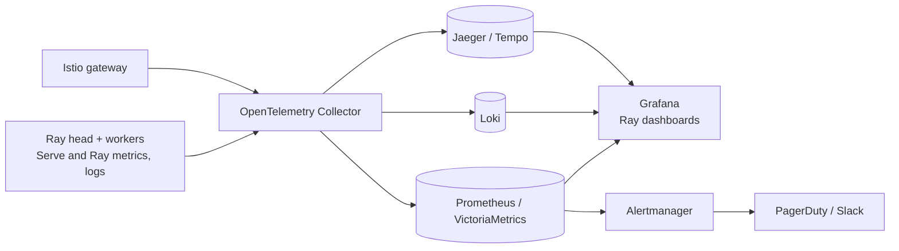
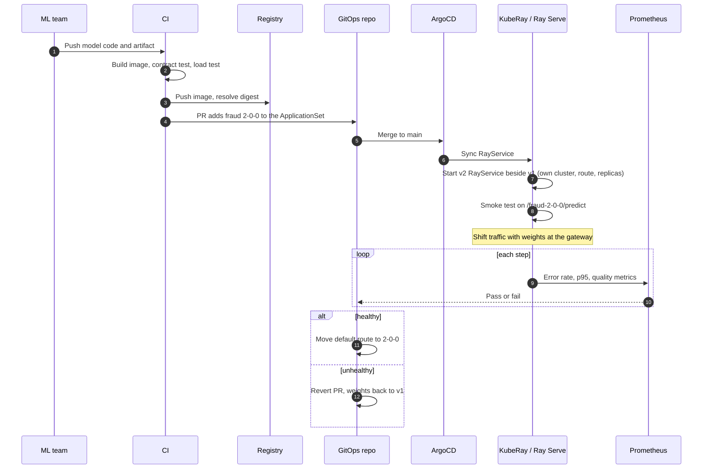

# Scalable Multi-Model Inference Service - Design

Design for the brief: models arrive from the ML team as Docker images that serve one inference per HTTP call at predefined endpoints; many models and many versions run at once and each scales independently.

The model-hosting layer is the Ray ecosystem: Ray Serve for serving, KubeRay for running Ray on Kubernetes, and the Ray autoscaler for capacity. The brief does not prescribe tools; Ray is chosen because it gives per-version applications, per-version autoscaling and zero-downtime upgrades in one system.

## Contents

1. [Requirements and assumptions](#1-requirements-and-assumptions)
2. [Architecture](#2-architecture)
3. [Infrastructure toolkit](#3-infrastructure-toolkit)
4. [Monitoring and observability](#4-monitoring-and-observability)
5. [Operations](#5-operations)
6. [Trade-offs](#6-trade-offs)
7. [Working example in this repository](#7-working-example-in-this-repository)

## 1. Requirements and assumptions

| Requirement | Design response |
|---|---|
| Models arrive as Docker images with fixed HTTP endpoints | The image is the deployable unit: KubeRay runs it as the Ray head and worker pods, and Ray Serve exposes the endpoints |
| Many models, many versions at once | One `RayService` per model version, each with its own Serve application and route prefix |
| Independent scaling | Per-application `autoscaling_config` scales replicas; the Ray autoscaler scales worker pods; Karpenter scales nodes |
| Resilient and reliable | Multi-AZ worker groups, GCS fault tolerance, PodDisruptionBudgets, request back-pressure, zero-downtime upgrades |

Assumptions:

- Synchronous request/response inference, a mix of CPU and GPU models, managed Kubernetes (EKS/GKE/AKS).
- The image is built `FROM rayproject/ray:<version>` (or contains the same Ray version) and exposes a Serve application. Endpoint contract per version: `POST /<model>-<version>/predict` and `GET /<model>-<version>/health`, verified by a CI contract test.
- An image that is only a plain HTTP server needs a thin Ray Serve wrapper around it. The platform provides a template for this, so the ML team only supplies the model code.

## 2. Architecture



### 2.1 Request path

1. Clients reach a managed edge, then the Istio ingress gateway. TLS termination, authentication (JWT/mTLS) and global rate limits live here.
2. Routing is by path prefix `/<model>-<version>/` to the Serve service of that version's RayService. Clients that need reproducibility pin a version.
3. The Ray Serve proxy forwards the request to a replica of that application, using power-of-two-choices routing with a per-replica queue limit.

### 2.2 Per-model and per-version units

| Unit | Ray object | Defined by |
|---|---|---|
| Model version | `RayService` (head group, one or more worker groups, serve config), one ArgoCD Application | Helm chart `mlmodel-ray`, one entry in the ApplicationSet |
| Serve application | Ray Serve application in `serveConfigV2` (`import_path`, `route_prefix`, `args`, deployment options) | `serve.applications` in the chart values |
| Image | Pod template of the head and worker groups | `image.tag`, pinned by digest in production |

Each application declares `num_cpus` / `num_gpus`, `max_ongoing_requests`, `health_check_period_s` and its `autoscaling_config`. Every version has its own Ray cluster, so versions share no process, Python environment or failure domain, and each can use a different image and dependencies. A model's versions that share an environment can optionally be grouped as several Serve applications in one RayService to reduce idle overhead.

### 2.3 Independent scaling



- **Replicas:** every application has its own `autoscaling_config` (`min_replicas`, `max_replicas`, `target_ongoing_requests`, up/down-scale delays). Replicas are scaled on ongoing requests per replica, so a hot version scales without touching the others.
- **Worker pods:** with `enableInTreeAutoscaling`, the Ray autoscaler adds worker pods when replicas cannot be scheduled and removes them after `idleTimeoutSeconds`. Each worker group has its own `minReplicas` and `maxReplicas`, with GPU and CPU groups separated.
- **Nodes:** Karpenter provisions right-sized nodes for pending pods, using spot for burst and on-demand for baseline.
- **Replica floor:** `min_replicas >= 2` for tier-1 versions; low-traffic versions can run at 1. Scale to zero is possible (`min_replicas: 0`) at the cost of cold start.
- **Cold start:** models are baked into the image or pulled to a node-local cache; replicas pass a health check only after the model is loaded; image pre-pulling reduces pod start time.

### 2.4 Resiliency and reliability

| Concern | Mechanism |
|---|---|
| Replica crash or hang | Serve restarts failed replicas and health-checks them (`health_check_period_s`, `health_check_timeout_s`) |
| Worker pod or node failure | Ray reschedules replicas on healthy workers; the Ray autoscaler replaces the pod; PodDisruptionBudgets limit voluntary disruption |
| Zone failure | Worker groups spread over at least 3 zones with topology spread constraints |
| Head pod failure | GCS fault tolerance with external Redis keeps cluster state, so the head restarts without dropping serving workers |
| Unhealthy cluster | KubeRay `serviceUnhealthySecondThreshold` and `deploymentUnhealthySecondThreshold` trigger preparation of a replacement cluster |
| Overload | `max_ongoing_requests` and `max_queued_requests` apply back-pressure and return 503 instead of queue collapse; gateway rate limits in front |
| Slow upstream | Istio timeouts, bounded retries and outlier detection at the gateway |
| Noisy neighbour | Separate RayService per version, separate worker groups per resource profile, namespace quotas |
| Bad release | Staged rollout and rollback (section 5) |
| Bad config or infra change | Everything in Git, reviewed, applied by ArgoCD; rollback is `git revert` |
| Secrets and network | SOPS with a cloud KMS key, mTLS in the mesh, default-deny network policies |

Default SLOs per version: 99.9% availability of non-4xx requests and a p95 latency target agreed with the ML team. Error budgets gate rollouts.

## 3. Infrastructure toolkit

| Layer | Tool | Why |
|---|---|---|
| Cloud infrastructure (network, cluster, registry, buckets, DNS, Redis) | Terraform / OpenTofu with remote state | Declarative, widest provider support, plan reviewed in PRs, separate state per environment |
| Cluster add-ons and workloads | ArgoCD with ApplicationSets | Git is the source of truth; drift detection and self-heal; audit trail; easy rollback |
| Model hosting | Ray Serve on KubeRay (`RayService`) | Per-version applications and autoscaling, zero-downtime upgrades, operator-managed lifecycle |
| Packaging | Helm (`mlmodel-ray` chart), Kustomize overlays per environment | The ML team edits only values |
| Node autoscaling | Karpenter | Fast, right-sized node provisioning including GPU and spot |
| Traffic management | Istio | mTLS, authentication, retries, timeouts, weighted routing between RayServices |
| Secrets | SOPS with a cloud KMS key (age for local use) | GitOps-compatible, no plaintext in Git, access controlled through IAM |
| CI | GitHub Actions | Build the image, contract test, open the GitOps PR |

Proposed layout (mono-repo, promotion by directory):

```
infra/terraform/{modules,envs/{dev,staging,prod}}
platform/                          ArgoCD, KubeRay, Istio, Karpenter, observability
apps/models/applicationset.yaml    list of model versions; one ArgoCD Application and RayService per entry
helm/mlmodel-ray/
```

A new version is a PR adding an entry to the ApplicationSet (and a new image tag if the code changed).

## 4. Monitoring and observability



- **Metrics**, per application (`application` label carries model and version):
  - Ray Serve: request count, error count, latency histograms, queue length, ongoing requests, replica count, replica start and health-check failures.
  - Ray cluster: node, actor and task state, CPU/GPU/memory utilisation, autoscaler pending and failed nodes.
  - Edge: request rate, errors and latency from the Istio gateway, which also covers requests that never reach Ray.
  - Kubernetes: restarts, OOM kills, pending pods, image-pull time.
- **Collection:** Ray exports Prometheus metrics on every node; a `PodMonitor` scrapes them. Ray's Grafana dashboards are provisioned from the head.
- **Logs:** Serve writes structured JSON logs with application, deployment, replica and request ID; the OTel Collector ships them to Loki.
- **Traces:** Ray Serve OpenTelemetry tracing with W3C trace context from the gateway; tail sampling keeps errors and slow requests.
- **Model quality:** sampled, privacy-reviewed input and output records go to object storage; drift and prediction-distribution checks run per version, and canary comparisons use the same checks.
- **Alerting:** multi-window burn-rate SLO alerts (page on fast burn, ticket on slow burn), plus replica crash loops, scaling pinned at `max_replicas`, autoscaler failing to add nodes, queue growth and drift. Every alert links to a runbook.

## 5. Operations

### 5.1 Rolling out a new model version



How the change reaches Ray depends on what changed:

| Change | What happens |
|---|---|
| New version (new artifact or image) | A new entry in the ApplicationSet creates a new Application and RayService next to the old one; existing versions are not touched |
| Image, Ray version or head change | KubeRay zero-downtime upgrade: it creates a new Ray cluster, waits until all Serve applications are healthy, then switches the service to it and removes the old cluster |
| Serve config change only | Applied in place to the running cluster through the Serve REST API, without restarting pods |

- **Versions are additive and immutable.** v2 runs beside v1, so rollback is a routing change that takes seconds.
- **Traffic shifting:** clients pin a version by route. For gradual rollouts, an Istio `VirtualService` splits an alias route between two versions (for example 95/5, then 75/25, then 100), and metrics are compared at each step.
- **Environments:** dev, then staging (replayed traffic), then prod, each promoted by Git PR.
- **Gates:** contract test, performance comparison with the previous version, canary analysis, optional manual approval for tier-1 models.
- **Release namespaces (blue/green):** where whole releases rather than single versions change, deploy the full set of RayServices into a new release namespace (for example `blue` and `green`), validate it, then move traffic at the gateway.
- **Deprecation:** after N days without traffic, announce retirement, then remove the entry from the ApplicationSet; ArgoCD prunes the Application and its RayService. Images stay in the registry for reproducibility.
- **Rollback:** `git revert` of the PR, or weights set back at the gateway.

### 5.2 Updating services

Config and chart changes follow the same PR and ArgoCD flow, and `selfHeal` reverts manual drift. Serve-level changes are applied in place; pod-level changes go through the KubeRay zero-downtime upgrade, and PodDisruptionBudgets plus graceful shutdown let in-flight requests drain.

### 5.3 Updating infrastructure

| Change | Approach |
|---|---|
| Terraform changes | PR, `plan` posted as a comment, approval, `apply` in CI; promoted dev, staging, prod |
| Kubernetes version | Blue/green clusters for prod: build the new cluster with Terraform, let ArgoCD sync workloads, shift traffic with DNS or load balancer weights. In-place control-plane upgrade plus rolling node-pool replacement is the alternative |
| KubeRay, Istio, Prometheus | Pinned chart versions, Renovate PRs, tested in dev and staging; upgrade the KubeRay operator before changing Ray versions in images |
| Ray version | New image with the new Ray version; rolled out by the KubeRay zero-downtime upgrade after testing in staging |

## 6. Trade-offs

| Choice | Reason | Cost and mitigation |
|---|---|---|
| Ray Serve for hosting | Per-version applications and autoscaling, model composition, GPU fractions, built-in zero-downtime upgrades | The image must be Ray-compatible. A plain HTTP image needs a thin Ray wrapper, which the platform template provides |
| One RayService per model version (a model's versions can alternatively share one RayService as separate Serve applications) | Full isolation: each version has its own head, workers, failure domain and upgrade path, and is visible as its own ArgoCD Application | More head pods and idle overhead. Versions of one model that share an environment can be grouped in one RayService to cut cost |
| Ray autoscaler plus Karpenter | Ray decides how many workers; Karpenter finds nodes | Two autoscalers to tune; keep Ray's `idleTimeoutSeconds` above node start time |
| Single region by default | Cost and complexity are justified only for tier-1 SLOs | Cluster is rebuilt from Terraform and ArgoCD; tier-1 can add a second region |

## 7. Working example in this repository

The repository includes a runnable subset, deployed with `make install` onto an existing cluster that has ArgoCD. It implements the Ray-based design at demo scale.

| Aspect | Working example | Production design (sections 2-5) |
|---|---|---|
| Delivery | ArgoCD ApplicationSet (`apps/models/applicationset.yaml`) generating one Application per model version | Same, with generators across environments |
| Packaging | Helm charts in `helm/` | Same |
| Image | One image, `mlmodel`, built by CI from `mlmodel/`, with `.joblib` models baked in | One image per model from the ML team |
| Model unit | A RayService per model version, each with one Serve application | Same, grouping versions only where they share an environment |
| Pod scaling | Serve `autoscaling_config` per version | Same |
| Node scaling | Ray autoscaler adds worker pods (`enableInTreeAutoscaling`); nodes come from the cluster | Plus Karpenter |
| Routing | Path prefix per version on the Serve service | Istio gateway with host routing and weights |
| Observability | Ray Dashboard and metrics endpoint | Full OTel, Prometheus, Grafana, Loki, Jaeger stack |
| Rollout | Add a list entry to the ApplicationSet, push; revert to roll back | Staged traffic shift with metric gates |

Known limitation of the example: each Ray head is a single pod without GCS fault tolerance.

Example diagrams: [architecture](diagrams/architecture.md), [adding a version](diagrams/rollout.md).
