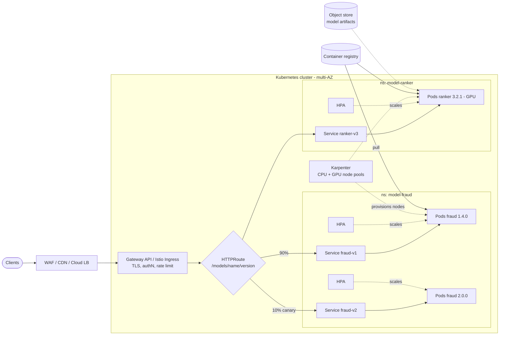
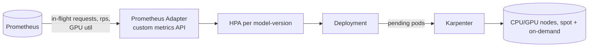
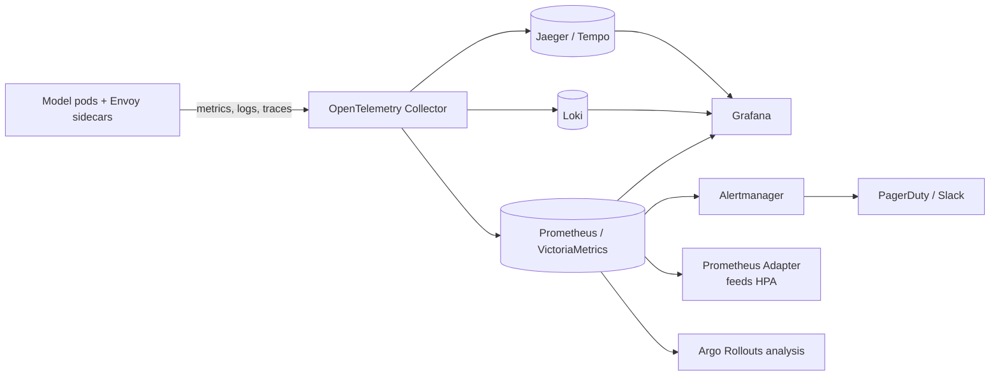
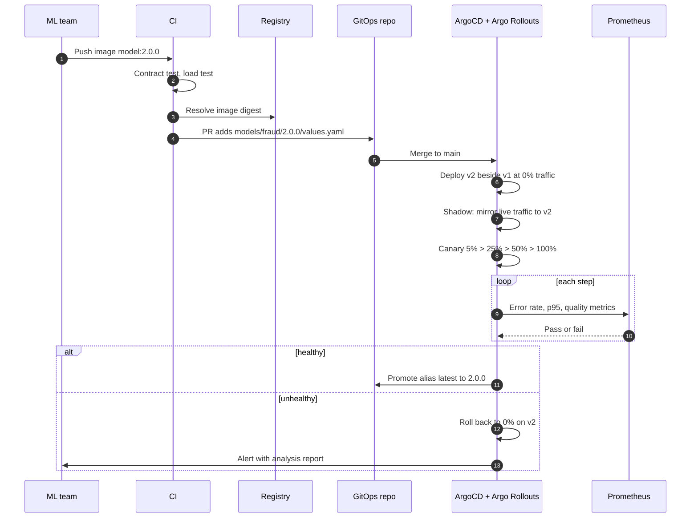

# Scalable Multi-Model Inference Service - Design

Design for the brief: models arrive from the ML team as Docker images that serve one inference per HTTP call at predefined endpoints; many models and many versions run at once and each scales independently.

## Contents

1. [Requirements and assumptions](#1-requirements-and-assumptions)
2. [Architecture](#2-architecture)
3. [Infrastructure toolkit](#3-infrastructure-toolkit)
4. [Monitoring and observability](#4-monitoring-and-observability)
5. [Operations](#5-operations)
6. [Trade-offs and alternatives](#6-trade-offs-and-alternatives)
7. [Working example in this repository](#7-working-example-in-this-repository)

## 1. Requirements and assumptions

| Requirement | Design response |
|---|---|
| Models arrive as Docker images with fixed HTTP endpoints | Each image is an opaque, immutable artifact; the platform adds no code to it |
| Many models, many versions at once | One Kubernetes `Deployment` per model-version, namespace per model |
| Independent scaling | One HorizontalPodAutoscaler per model-version with its own bounds and resource profile |
| Resilient and reliable | Multi-AZ, PodDisruptionBudgets, probes, mesh retries and circuit breaking, no shared state between versions |

Assumptions: synchronous request/response inference; mix of CPU and GPU models; managed Kubernetes (EKS/GKE/AKS). Container contract: `POST /predict`, `GET /healthz`, `GET /metrics` (Prometheus format), verified by a CI conformance test rather than trusted.

## 2. Architecture

The proposal builds on a stack that is already proven in a comparable platform: ArgoCD with ApplicationSets, Helm and Kustomize, Istio, Karpenter and cluster-autoscaler, a VictoriaMetrics, Loki, OTel and Grafana observability stack, and SOPS for secrets. That platform serves models with Ray Serve on KubeRay, one RayService per release namespace, with CPU and GPU worker groups and the Ray autoscaler. This design keeps that tooling and differs in the unit of deployment: a Deployment per model-version, so that arbitrary ML-team Docker images can be hosted with full isolation. Ray Serve remains the choice when many small models share a runtime (section 7).



### 2.1 Request path

1. Clients reach a managed edge (WAF, CDN, cloud load balancer), then the in-cluster gateway (Gateway API with Istio or Envoy Gateway). TLS termination, authentication (JWT/mTLS) and global rate limits live here.
2. Routing is by path `/models/<name>/<version>/...`. An alias `/models/<name>/latest` carries weights that change during rollouts. Clients that need reproducibility pin a version.
3. Each route targets a per-version `Service`. Versions share no process and no pool, so a bad version cannot starve another.

### 2.2 Per-model-version unit

Every version is rendered from one Helm chart into:

- `Deployment` (image pinned by digest), `Service`, `HTTPRoute` rule
- `HorizontalPodAutoscaler` (autoscaling/v2) with per-version bounds and metrics
- `PodDisruptionBudget`, default-deny `NetworkPolicy`, least-privilege `ServiceAccount`
- `ServiceMonitor` and `PrometheusRule` for SLO alerts
- resource requests/limits, node selector and tolerations (CPU vs GPU pools), topology spread across zones

The ML team supplies only the image, resource profile, scaling bounds and a small values file.

### 2.3 Independent scaling



- **Pods:** each version has its own HPA. Prometheus Adapter exposes inference-relevant metrics through the custom metrics API, primarily in-flight requests per pod, with request rate and GPU utilisation as alternatives. Each version has its own min/max replicas and stabilisation windows.
- **Replica floor:** `minReplicas >= 2` for tier-1 models and 1 for the rest. Idle or old versions are retired through the deprecation process (section 5.1) rather than scaled to zero.
- **Nodes:** Karpenter provisions right-sized nodes from separate GPU and CPU pools, using spot for burst and on-demand for baseline. Image pre-pulling reduces cold start.
- **Cold start:** weights baked into the image or pulled from a node-local cache; a `startupProbe` keeps traffic away until the model is loaded.
- **Guardrails:** `ResourceQuota` and `LimitRange` per namespace, `PriorityClass` for tier-1 models.

### 2.4 Resiliency and reliability

| Concern | Mechanism |
|---|---|
| Node or zone failure | Pods spread across at least 3 zones; PDBs keep a minimum available during drains |
| Unhealthy pod | Readiness, liveness and startup probes; Envoy outlier detection ejects bad endpoints |
| Slow or failing upstream | Per-route timeouts, bounded retries with retry budgets, circuit breakers |
| Overload | Gateway rate limits, per-pod concurrency cap, load shedding (429/503) instead of queue collapse |
| Noisy neighbour | Namespace quotas, requests equal to limits for GPU pods, dedicated pools for critical models |
| Bad release | Progressive delivery with automatic rollback (section 5) |
| Bad config or infra change | Everything in Git, reviewed, applied by ArgoCD; rollback is `git revert` |
| Cluster or region loss | Cluster rebuilt from Terraform and ArgoCD; tier-1 models run active-active in two regions behind global load balancing |
| Secrets and network | External Secrets or SOPS with a cloud KMS key, mTLS in the mesh, default-deny network policies |

Default SLOs per model-version: 99.9% availability of non-4xx requests and a p95 latency target agreed with the ML team. Error budgets gate rollouts.

## 3. Infrastructure toolkit

| Layer | Tool | Why |
|---|---|---|
| Cloud infrastructure (network, cluster, node roles, registry, buckets, DNS) | Terraform / OpenTofu with remote state | Declarative, widest provider support, plan reviewed in PRs, separate state per environment |
| Cluster add-ons and workloads | ArgoCD with ApplicationSets | Git is the source of truth; drift detection and self-heal; audit trail; easy rollback |
| Packaging | Helm (one reusable `model-service` chart), Kustomize overlays per environment | Consistent defaults; ML team edits only values |
| Pod autoscaling | Kubernetes HPA (autoscaling/v2) + Prometheus Adapter | Built into Kubernetes, no extra controller to operate; scales each version on custom inference metrics |
| Node autoscaling | Karpenter | Fast, right-sized node provisioning including GPU and spot |
| Traffic and progressive delivery | Gateway API + Istio, Argo Rollouts or Flagger | mTLS, weighted routing, mirroring, retries; metric-driven canary analysis |
| Secrets | SOPS with a cloud KMS key (age for local use), or External Secrets Operator | GitOps-compatible, no plaintext in Git, access controlled through IAM |
| CI | GitHub Actions | Lint, container conformance test, open the GitOps PR |

Proposed layout (mono-repo, promotion by directory):

```
infra/terraform/{modules,envs/{dev,staging,prod}}
platform/                          ArgoCD, Istio, Karpenter, observability
models/<name>/<version>/values.yaml
charts/model-service/
```

A new version is a PR adding `models/<name>/<version>/values.yaml`. An ApplicationSet with a Git directory generator discovers it and creates the ArgoCD Application.

## 4. Monitoring and observability



- **Metrics**, labelled by `model` and `version`:
  - Traffic, errors and latency (p50/p95/p99) from the mesh, so it works for any image.
  - Saturation: in-flight requests, CPU, memory, GPU utilisation and memory.
  - Platform: restarts, OOM kills, pending pods, scale events, cold-start and image-pull time.
  - Cost per version via OpenCost.
- **Logs:** structured JSON to stdout, collected by the OTel Collector into Loki, with `trace_id` for correlation.
- **Traces:** W3C trace context from the gateway through to the model, with tail sampling that keeps errors and slow requests.
- **Model quality:** sampled, privacy-reviewed input and output records go to object storage; drift and prediction-distribution checks (Evidently) run per version. Shadow and canary comparisons feed the same checks.
- **Dashboards:** generated per model-version, plus a fleet overview and a canary-versus-stable view.
- **Alerting:** multi-window burn-rate SLO alerts (page on fast burn, ticket on slow burn), plus crash loops, scaling pinned at max, GPU saturation and drift. Every alert links to a runbook.

## 5. Operations

### 5.1 Rolling out a new model version



- **Versions are additive and immutable.** v2 is a new Deployment; v1 keeps running untouched, so rollback is a routing change that takes seconds.
- **Environments:** dev, then staging (synthetic and replayed traffic), then prod, each promoted by Git PR.
- **Gates:** contract test, performance comparison with the previous version, canary analysis, optional manual approval for tier-1 models.
- **Release namespaces (blue/green):** where whole releases rather than single versions change, deploy the full set of model versions into a new release namespace (for example `blue` and `green`), validate it, then move traffic. This is the lowest-effort step up from a plain image-tag bump and needs no extra tooling beyond the gateway.
- **Deprecation:** after N days without traffic, announce retirement, then delete the values file and ArgoCD prunes it. Images stay in the registry for reproducibility.
- **Rollback:** automatic on failed analysis; manual with `git revert` or by setting weights back.

### 5.2 Updating services

Config and chart changes follow the same PR and ArgoCD flow, and `selfHeal` reverts manual drift. Deployments use `RollingUpdate` with `maxUnavailable: 0`, readiness gates and PDBs. A `preStop` hook and `terminationGracePeriodSeconds` let in-flight requests drain.

### 5.3 Updating infrastructure

| Change | Approach |
|---|---|
| Terraform changes | PR, `plan` posted as a comment, approval, `apply` in CI; promoted dev, staging, prod |
| Kubernetes version | Blue/green clusters for prod: build the new cluster with Terraform, let ArgoCD sync workloads, shift traffic with DNS or load balancer weights. In-place control-plane upgrade plus rolling node-pool replacement is the alternative |
| Add-ons (Istio, Prometheus) | Pinned chart versions, Renovate PRs, tested in dev and staging; revision-based canary upgrades for Istio |

## 6. Trade-offs and alternatives

| Choice | Alternative | Reason |
|---|---|---|
| One Deployment per model-version | Shared multi-model server (Triton, Ray Serve, Seldon) | Arbitrary ML-team images, plus independent failure and scaling domains. Cost: more pods and idle overhead, mitigated by retiring unused versions and right-sizing requests. A shared server wins when many small models can share one runtime or GPU |
| HPA + Prometheus Adapter | KEDA or Knative | Native HPA keeps the platform small. KEDA or Knative would add scale to zero, at the cost of another control plane; worth revisiting if many rarely used versions make idle cost significant |
| Single region by default | Active-active multi-region | Cost and complexity are justified only for tier-1 SLOs |

## 7. Working example in this repository

The repository includes a runnable subset, deployed with `make install` onto an existing cluster that has ArgoCD. It uses a different runtime from the proposal: KubeRay and Ray Serve, which hosts several model versions per family inside one Ray cluster.

| Aspect | Working example | Proposal (sections 2-5) |
|---|---|---|
| Delivery | ArgoCD syncing `apps/*/application.yaml` from a private repo | Same |
| Packaging | Helm charts in `helm/` | Same |
| Model unit | A Ray Serve application per version, from a `.joblib` artifact in a shared serving image | A Deployment per version from an arbitrary ML-team image |
| Pod scaling | Ray Serve `autoscaling_config` per version (`target_ongoing_requests`, min/max) | HPA per version |
| Node scaling | Ray autoscaler adds worker pods (`enableInTreeAutoscaling`); nodes come from the cluster | Karpenter |
| Routing | Path prefix per version on the Ray Serve service; optional host-based Istio routing in the chart | Gateway API + Istio with weights |
| Isolation | One RayService per model family; versions in a family share a cluster | Full per-version isolation |
| Observability | Ray Dashboard and metrics endpoint | Full OTel, Prometheus, Grafana, Loki, Jaeger stack |
| Rollout | Add an entry to `serve.applications`, push; revert to roll back | Shadow, canary and automatic rollback |

Known limitation of the example: the Ray head is a single pod per family without GCS fault tolerance.

Example diagrams: [architecture](diagrams/architecture.md), [adding a version](diagrams/rollout.md).
