# Demo architecture

```mermaid
flowchart LR
    dev([Developer]) -->|git push| repo[(GitHub repo<br/>cf-assignment, private)]
    dev -->|make install| mk[Makefile]
    mk -->|repo-credentials secret| argo
    mk -->|kubectl apply apps/*| argo

    subgraph cluster[Kubernetes cluster]
        argo[ArgoCD]
        argo -->|sync| op

        subgraph nsop[ns: kuberay-operator]
            op[KubeRay operator]
        end

        subgraph nsml[ns: mlops]
            subgraph rf1[RayService random-forest-1-0-0]
                rf1svc[Service serve-svc :8000] --> rf1app[Serve app<br/>1-4 replicas]
            end
            subgraph rf2[RayService random-forest-1-0-1]
                rf2svc[Service serve-svc :8000] --> rf2app[Serve app<br/>1-4 replicas]
            end
            subgraph rf3[RayService random-forest-2-0-0]
                rf3svc[Service serve-svc :8000] --> rf3app[Serve app<br/>1-4 replicas]
            end
            subgraph lr1[RayService logistic-regression-1-0-0]
                lr1svc[Service serve-svc :8000] --> lr1app[Serve app<br/>1-4 replicas]
            end
            subgraph lr2[RayService logistic-regression-1-0-1]
                lr2svc[Service serve-svc :8000] --> lr2app[Serve app<br/>1-4 replicas]
            end
        end

        argo -->|ApplicationSet: one Application per version| nsml
        op -->|manages| nsml
    end

    repo -->|pulled by| argo
    hub[(Docker Hub<br/>omegazyadav/mlmodel)] -->|image pull| nsml
    user([Client]) -->|kubectl port-forward| nsml
```

- One ApplicationSet (`apps/models/applicationset.yaml`) lists the model versions and generates one ArgoCD Application and one RayService per entry, so each version is visible in the ArgoCD UI.
- Each version has its own Ray cluster, route prefix (for example `/random-forest-2-0-0/predict`) and replica bounds, so versions fail, upgrade and scale independently.
- Replicas scale on `target_ongoing_requests`; the Ray autoscaler (`enableInTreeAutoscaling`) adds or removes worker pods when replicas need more capacity.
