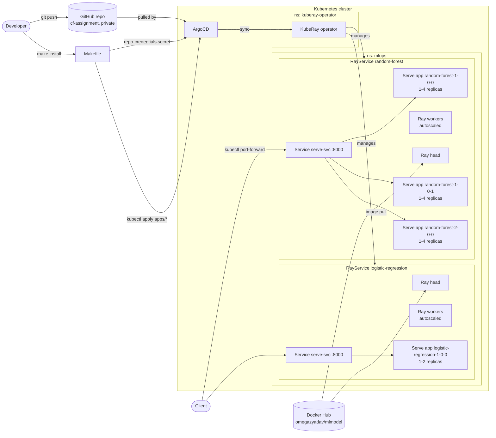

# Demo architecture

- Each model family is its own RayService (own Ray cluster), so one family's failure or redeploy does not affect the other.
- Each version is a Serve application with its own route prefix (for example `/random-forest-2-0-0/predict`) and its own replica bounds, so versions scale independently.
- Replicas scale on `target_ongoing_requests`; the Ray autoscaler (`enableInTreeAutoscaling`) adds or removes worker pods when replicas need more capacity.
